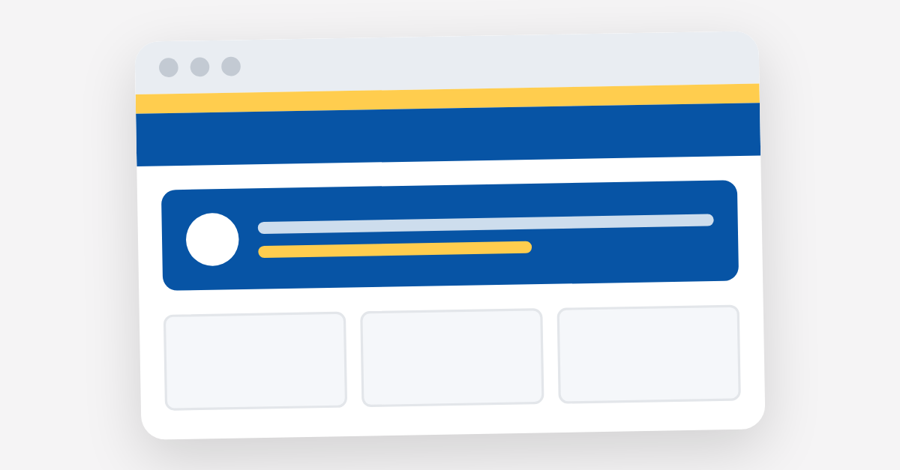

# Pierre DER GAZERIAN · Digital Portfolio



Mon portfolio en ligne, pensé comme une boutique Decathlon où le produit… c'est moi.
Je suis étudiant en Pré-MSc à Epitech Marseille et je cherche une **alternance de 33 mois en data & IA** (ou en cybersécurité & cloud).

🔗 **Site en ligne : [pierreder13.github.io/PortFolio](https://pierreder13.github.io/PortFolio/)**

---

## Le concept

Plutôt qu'un portfolio classique, le site reprend les codes d'un site e-commerce que tout le monde connaît :

| Élément Decathlon | Dans le portfolio |
|---|---|
| Bandeau promo jaune | « Open to work » qui défile, avec un lien vers le contact |
| Header bleu + menu collé en haut | Logo, nom, et navigation Projects · Resume · About · Contact |
| Barre de recherche | Recherche en direct dans les cartes **et** dans les projets |
| Rayons et fiches articles | Page Projects : filtres, fiches projet avec « coloris » |
| Fiche produit avec choix de taille | Page About : choix du domaine Data & AI / Cybersecurity & Cloud |
| Service client | Page Contact : 4 canaux + formulaire |

Pourquoi Decathlon ? Parce que j'ai envie de mettre mes appétences au service du sport et de sa R&D.

## Les pages

- **Accueil** : bannière avec ma photo, mon objectif et trois boutons (projets, **téléchargement du CV en PDF**, contact), puis trois cartes d'entrée. Pendant une recherche, la bannière s'efface pour laisser place aux résultats.
- **Projects** : fil d'Ariane, filtres *All / Online / In progress*, et une fiche par projet :
  - **CozyDesk** : job board cosy en pixel art, fait en équipe à Epitech (front React, API Flask par un coéquipier). [Démo](https://cozydesk-demo.vercel.app/)
  - **Java Game** : jeu en Java, en cours de développement
  - **This Portfolio** : le site lui-même
- **About** : galerie photo, choix du domaine, caractéristiques (mobilité, permis, anglais, disponibilité) et onglets dépliables : profil, compétences, parcours, centres d'intérêt.
- **Contact** : email, LinkedIn, GitHub, CV en PDF, et un formulaire qui ouvre la messagerie avec le message déjà rédigé.
- **Resume** : mon CV en ligne, sur son propre dépôt ([My_Resume](https://github.com/PierreDer13/My_Resume)).

## Identité visuelle

- **Couleurs** : bleu `#0754A5` (header, titres), jaune `#FFCD4E` (bandeau, bouton CV, badges), bleu action `#0875E1` (boutons), gris `#616161` (textes secondaires)
- **Police** : Inter (Regular, Bold, ExtraBold)
- **Logo « Arc souple »** : un P stylisé blanc d'un seul geste, utilisé dans le header et comme icône d'onglet

## Accessibilité et qualité

- Textes alternatifs sur les images, libellés invisibles mais lus par les lecteurs d'écran
- Navigation complète au clavier, page active et filtres signalés (`aria-current`, `aria-pressed`)
- Contrastes lisibles, bandeau défilant qui s'arrête au survol et se coupe si l'utilisateur désactive les animations
- Référencement : titre, langue, meta description, et aperçu de partage LinkedIn / réseaux sociaux (Open Graph)
- Affichage adapté aux ordinateurs, tablettes et téléphones

## Stack technique

- **React 18** + **Vite 5**, sans autre dépendance
- Navigation entre les pages avec un petit routeur maison (`useHashRoute` dans `App.jsx`), basé sur le `#` de l'URL : pas d'erreur 404 sur GitHub Pages
- Contenu séparé de l'affichage : tous les textes, liens et projets sont dans `src/data.js` et `src/aboutData.js`

## Structure

```
├── .github/workflows/deploy.yml   # build + mise en ligne automatique sur GitHub Pages
├── index.html                     # page HTML de base, balises SEO et Open Graph
├── public/                        # fichiers publiés tels quels (CV PDF, favicon, image de partage)
└── src/
    ├── main.jsx                   # point d'entrée : monte l'application
    ├── App.jsx                    # structure commune + choix de la page (routeur)
    ├── data.js                    # contenu : liens, cartes d'accueil, projets, contact
    ├── aboutData.js               # contenu de la page About
    ├── index.css                  # styles communs
    ├── components/                # AnnouncementBar, Header, Nav, SearchBar, Hero, Footer,
    │                              # Categories, CategoryCard, ProjectCard, Mug3D, SiteMock…
    └── pages/                     # Home, Projects, About, Contact (+ leur CSS)
```

Pour **ajouter un projet** : copier un objet dans le tableau `projects` de `src/data.js` et changer les valeurs, sans toucher aux composants.

## Lancer en local

```bash
npm install
npm run dev
```

Puis ouvrir l'adresse affichée (par défaut http://localhost:5173).

Pour générer la version finale : `npm run build` (le site est créé dans `dist/`).

## Déploiement

Chaque `git push` sur `main` lance le workflow `.github/workflows/deploy.yml`, qui installe les dépendances, construit le site et le publie sur GitHub Pages. Le site est à jour en environ deux minutes, sans aucune manipulation.

## Contact

- ✉️ pierre.der-gazerian@epitech.eu
- 💼 [LinkedIn](https://www.linkedin.com/in/pierre-der-gazerian-566a941b8/)
- 💻 [GitHub](https://github.com/PierreDer13)

© 2026 Pierre DER GAZERIAN · Built with React
